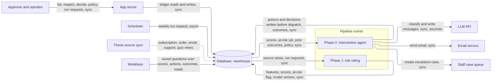
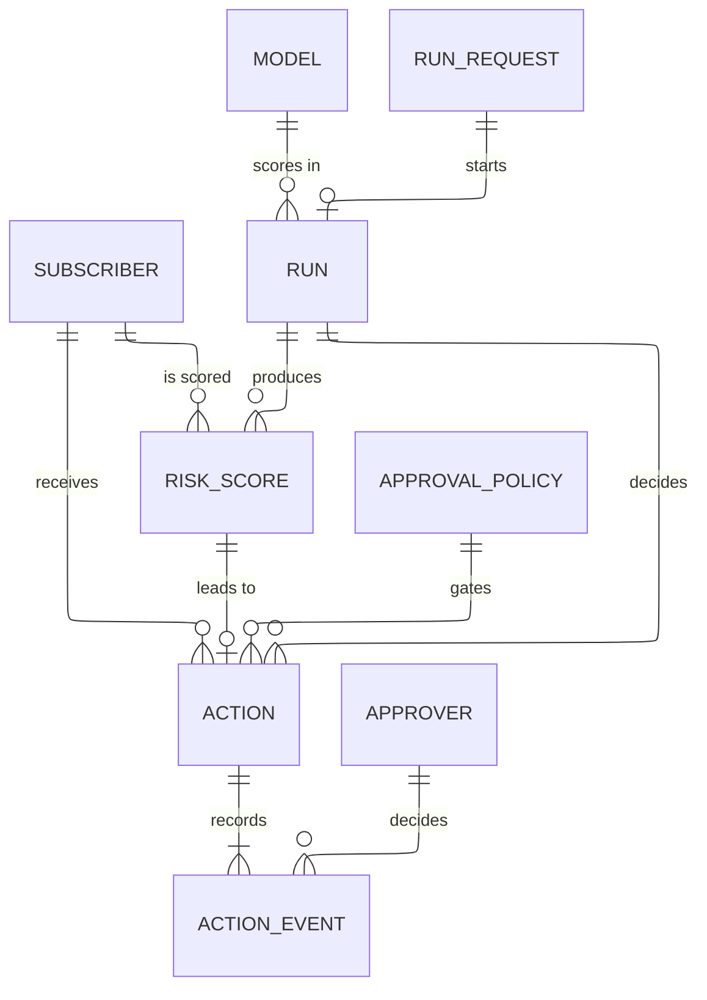
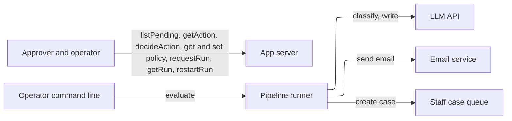

# HIGH_LEVEL_DESIGN.md — Thesis Churn Prevention Agent

**What this document is.** The parts the system needs and why, sized to the load it actually has. It names kinds of component, not products — `STACK.md` picks the products. How the code is organized inside the app is `ARCHITECTURE.md`. Requirement IDs refer to `docs/REQUIREMENTS.md`; metric numbers come from `docs/KEY_METRICS.md`. **[assumed]** marks a number taken without data; each is listed in §7. Snowflake and FastAPI are named only because the requirements fix them (GC-5, GC-7).

## Summary

- **Load:** 50,000 active subscribers (interim, SC-1; user, 2026-10-17), 100,000 for the load test. There is almost no interactive traffic (under 1 request/s, from a handful of staff). The real load is one batch run per week that must finish in 6 hours (SC-1) and makes about 20,000 LLM calls. About 3 GB of results per year.
- **Design:** Two phases in one long-running pipeline runner: **phase 1, risk rating** (read, features, score) and **phase 2, intervention agent** (classify, choose, write, approve, send, log outcomes). They hand off through the score table in the database. One small app server handles approvals and run control. One database holds everything. Calls go out to an LLM, an email service and a staff case queue.
- **Wireframe:** none — no screens. Approval and run control are API operations; the app server's built-in interactive API page is the demo interaction (GC-5 default tool).
- **Next as it grows:** a small transactional store for the action ledger, and a durable queue with a separate worker pool for the LLM stage. Triggers in §5.
- **Cost:** about $1,000/month at 50,000 subscribers, almost all LLM, which is uncapped (GC-4); about $2,000/month at 100,000. Under $100 during the build window.

## 1. Sizing answers

| # | Question | Answer | Source |
|---|---|---|---|
| 1 | Users now, growth, peak | Subscribers are data, not callers. Callers are one scheduler, one operator and a few approvers. 50,000 active subscribers **[assumed]**, tested at 100,000; doubling needs no code change. The peak is the run itself, not request traffic. | SC-1, SC-2, PF-2; user, 2026-10-17 |
| 2 | Read- or write-heavy | Batch: bulk reads of 5 views, then about 50,000 score rows and about 10,000 action records written per run. Interactive reads and writes are a few hundred per run. | GC-6, OB-2, FR-6 |
| 3 | Data that can never be lost | The action record, written before any send; approval decisions with who and when; the run record; the score history; approval-policy changes. Features, counts and cached views can be rebuilt. | RL-1, RL-2, AZ-3, OB-4, EV-1 |
| 4 | Latency expected | Run ≤ 6 h. Approve, reject and list ≤ 1 s. Life-change case visible ≤ 1 h after the decision. Audit row visible ≤ 15 min after dispatch. Failure reported ≤ 5 min. | SC-1, PF-3, OB-2, RL-4; the 1 s class is **[assumed]** |
| 5 | Cost ceiling | $0 outside the approved providers; LLM spend uncapped in the build; hosting on an approved host. | GC-4; builder, 2026-10-17 |

## 2. Interactions and load

| # | Interaction | R/W | How often | Peak/s | Expected latency | Data touched | Can be lost? | Source |
|---|---|---|---|---|---|---|---|---|
| I-1 | Scheduled run: both phases, whole base | R then W | weekly | batch | ≤ 6 h | source views, score, action, event, run | scores, actions, events: no | PF-1, PF-2, SC-1 |
| I-2 | Request a run now, restart a failed run | W | a few per week | < 0.1 | accept ≤ 1 s, run async | run request, run | no | FR-7.4, FR-7.5 (new) |
| I-3 | List pending approvals | R | per approver, a few per day | < 1 | ≤ 1 s | action, event | — | FR-6.1 |
| I-4 | Inspect one action | R | per decision | < 1 | ≤ 1 s | action, score, run, events | — | FR-6.1, FR-7.1, FR-7.2 |
| I-5 | Approve or reject | W | up to ~3,000 per run (worst case, see below) | < 1 | ≤ 1 s | action event | yes, never lose | FR-6.2, AZ-1, AZ-2 |
| I-6 | Send approved actions | W | polled every minute | batch | sent ≤ 5 min after approval **[assumed]** | action, event, email service | no | AZ-2, RL-2 |
| I-7 | Lapse stale pending actions | W | polled every minute | batch | lapse at ≤ 48 h or next charge | action event | no | RL-6 |
| I-8 | View or change approval policy | R/W | a few per month | < 0.1 | ≤ 1 s, effective next run | policy, policy change | no | FR-6.3, AZ-3 |
| I-9 | Create escalation case | W | per life-change subscriber | batch | visible ≤ 1 h after decision | action, staff case queue | no | FR-4, PF-3 |
| I-10 | Record outcomes of earlier actions | R then W | start of each run | batch | within the run | action event, subscription view | no | EV-8, FR-7.2 |
| I-11 | Train or refresh the model | R then W | each run **[assumed]** | batch | minutes | features, outcomes, model | model versions: no | FR-7.3, EV-8 |
| I-12 | Evaluate (backtest, per-archetype report) | R | on demand | batch | minutes | score history, outcomes | — | EV-1, EV-2, EV-6, EV-7 |
| I-13 | Metabase saved questions | R | staff, ad hoc | < 1 | seconds | scores, actions, outcomes | — | GC-7 |

**Arithmetic.**

- *At-risk set.* Top 20% of 50,000 (interim cutoff, Definitions) = **10,000** per run. At 100,000: 20,000.
- *LLM calls.* Each at-risk subscriber needs one call to classify the reason and one to write the message: 10,000 × 2 = **20,000 calls**. At 100,000: 40,000. A call takes 1–30 s; **10 s [assumed]**.
  - Serially: 20,000 × 10 s = 200,000 s ≈ **56 h**, against a 6 h limit.
  - Say the LLM stage gets **4 h** of the 6 (an hour for read, features and scoring, an hour for sending and logging **[assumed]**). Then calls in flight = 200,000 ÷ 14,400 s ≈ **14**. At 100,000: 400,000 ÷ 14,400 ≈ **28**. The runner must hold that many calls open and the provider's rate limit must allow it. (I said "about 10" when I pre-filled the answers, which ignored the hours the other stages need.)
  - VR-5 (no second message within 14 days) skips about half of a weekly run's at-risk set before any LLM call, so these are upper bounds.
- *Reading the source.* Computing features one subscriber at a time is 50,000 × ~5 queries × 0.1–0.5 s = **7–35 h**, over the limit before the LLM starts. Features must be built set-based, in the warehouse.
- *Writes.* Per run about 50,000 score rows and 10,000 action records plus about 4 events each. One row at a time at ~0.3 s is 10,000 × 0.3 s = 50 min for the actions alone; writing them in batches takes seconds.
- *Approvals.* EV-4 (>70% autonomous) allows up to 30% of dispatched actions to wait for a person: 3,000 per run. Over the 48 h lapse window that is one decision every ~58 s, non-stop. That is a human problem, not a server problem (§7).
- *Interactive peak.* 3 approvers, one click every 5 s each = 0.6 requests/s.
- *Storage per year, 52 runs.* Scores: 50,000 × 52 × 0.6 KB ≈ 1.6 GB. Actions (with scrubbed message): 10,000 × 52 × 2 KB ≈ 1 GB. Events: 10,000 × 52 × 4 × 0.2 KB ≈ 0.4 GB. About **3 GB/year**, 6 GB at 2×. Model files: a few MB per run.

Interactive peak is under 1 request/s and storage is gigabytes, so one small app server and one database have more than 100× headroom. The only number that forces a design choice is the LLM stage: 14 to 28 calls in flight for hours at a time.

## 3. Core entities

| Entity | What it is | Key attributes | Relations | Durability | Growth |
|---|---|---|---|---|---|
| Subscriber | A person in the subscription view. Read-only; here identified only by a surrogate id (CP-1) | surrogate id, status, plan, cycle, next charge date, order count | has many scores, actions | rebuildable (owned by the source views; never written here) | ~50,000, steady |
| Run | One execution of both phases | id, mode (dry-run or live), status, stage statuses, code, model and LLM versions, config snapshot, data freshness, counts, LLM calls, tokens, cost | has many scores, actions; uses one model | never lose (OB-4, EV-7) | 52/yr plus reruns |
| Run request | An ask to start or restart a run | kind (scheduled, now, restart), requested by, time | starts one run | disposable once the run starts | ~60/yr |
| Model | A trained scorer version | version, training snapshot, outcome snapshot used, backtest metrics, file | scores cite it | never lose (scores refer to it; a few MB) | 52/yr |
| Risk score | One subscriber's score in one run | run, surrogate id, score, ≥ 3 top factors with direction and size, at-risk flag | Subscriber, Run, Model | never lose (precision and recall are measured from old scores, EV-1) | 50,000 × 52 ≈ 2.6M/yr |
| Action | One intervention, one pending approval, or one logged decision to do nothing | id (doubles as idempotency key), run, subscriber, archetype, confidence, reason, intervention type, why chosen, scrubbed message, approval required, execution mode, case reference | Run, Score, many events | never lose (RL-2) | ~10,000 × 52 ≈ 520k/yr |
| Action event | One append-only step: proposed, approved, rejected, lapsed, dispatched, failed, outcome | action id, type, time, actor, detail | Action; Approver | never lose | ~4 per action ≈ 2M/yr |
| Approval policy | Which actions need approval (by intervention type, offer value, score) | rules, version | has many policy changes | never lose (AZ-3) | a few changes/month |
| Approver | An identity allowed to decide (AZ-1) | identity | decides events | rebuildable (from configuration) | a handful |

The action is append-only: its state is the latest event, never an updated column. Concurrent workers then only insert, which a warehouse handles well, and updates that would queue behind one another never arise.

**Access patterns**

| Read | Entities combined | How | At this scale |
|---|---|---|---|
| Pending list (I-3) | Action, Action event | actions from the last 2 days (lapse is ≤ 48 h), latest event each, sort by score or age | fine as a query: ~6,000 actions × ~4 events |
| Inspect one action (I-4) | Action, Score, Run, Action event | lookup by action id | fine as a query |
| Cooldown check (VR-5) | Action, Subscriber | all actions in the last 14 days for the at-risk set, once per run | fine as a query: ~20,000 rows |
| Duplicate-send guard (RL-1) | Action event | dispatched events for this run's actions, read at start and on restart | fine as a query |
| Features (phase 1) | Subscription, order, email, support, quiz views | aggregate to one row per subscriber | fine as set-based SQL in the warehouse. Row-by-row is not (§2: 7–35 h) |
| Backtest and per-archetype report (I-12) | Score history, cancellations, Action, outcomes | time-split join, group by archetype | fine as a query: millions of rows |
| Outcome capture (I-10) | Action, subscription view | join prior actions to what happened next | fine as a query |
| Metabase questions (I-13) | Scores, current action state, outcomes | three saved questions (GC-7) | fine as a query over a "current state of each action" view |

## 4. API operations

Grouped by the component that **serves** each operation, with who **calls** it. Routes are sketches; exact contracts are `ARCHITECTURE.md`'s.

### 4.1 App server

| Operation | Called by | Input | Output | R/W | Latency class | Sync / async | Serves |
|---|---|---|---|---|---|---|---|
| `listPending` — `GET /actions?status=pending` | Approver | optional sort, filter | actions with score, archetype, top factors, proposed message | R | ≤ 1 s | sync | I-3, FR-6.1 |
| `getAction` — `GET /actions/{id}` | Approver | action id | the action, its score, factors, message and event history | R | ≤ 1 s | sync | I-4, FR-6.1, FR-7.1, FR-7.2 |
| `decideAction` — `POST /actions/{id}/decision` | Approver | approve or reject, reason | the new state | W | ≤ 1 s | sync save; sending is async (I-6) | I-5, FR-6.2, AZ-1, AZ-2 |
| `getPolicy` / `setPolicy` — `GET`, `PUT /policy` | Approver or administrator | rules | the policy and its version | R / W | ≤ 1 s | sync; effective next run | I-8, FR-6.3, AZ-3 |
| `requestRun` — `POST /runs` | Operator | none (mode comes from configuration, never the request) | run request id | W | accept ≤ 1 s | async | I-2, FR-7.5 (new), DE-4 |
| `getRun` / `listRuns` — `GET /runs/{id}` | Operator | run id | status, stage durations, counts, freshness, versions | R | ≤ 1 s | sync | OB-3, OB-4 |
| `restartRun` — `POST /runs/{id}/restart` | Operator | run id | run request id | W | accept ≤ 1 s | async | I-2, FR-7.4 |

**Inside the app server (no caller):** none.

### 4.2 Pipeline runner

| Operation | Called by | Input | Output | R/W | Latency class | Sync / async | Serves |
|---|---|---|---|---|---|---|---|
| `evaluate` — command line | Operator | data snapshot, code version, seed | per-archetype report labelled real or synthetic | R | minutes | sync | I-12, EV-1, EV-2, EV-6, EV-7 |

**Inside the pipeline runner (no caller):**

| Work | Trigger | Does | Serves |
|---|---|---|---|
| Pick up a run | a run request appears, or the weekly schedule fires | creates the run and starts phase 1 | I-1, I-2, PF-2 |
| Record outcomes | start of every run | joins earlier actions to what the subscription view now shows and appends outcome events | I-10, EV-8 |
| **Phase 1 — risk rating** | after outcomes | checks the 5 views (DE-1), builds features (VR-6), refreshes the model from logged outcomes (FR-7.3), scores every active subscriber (PF-1) with ≥ 3 factors (VR-9), sets the at-risk flag | I-1, I-11 |
| **Phase 2 — intervention agent** | after scoring | for each at-risk subscriber: classify the reason, apply the routing table and cooldown (VR-1, VR-5), write the message (VR-2 to VR-4), scrub it (CP-1), write the action record, then send or queue for approval (AZ-2) or create a staff case (FR-4) | I-1, I-9, FR-5 |
| Send approved actions | every minute | sends actions that have an approval event and no dispatched event | I-6, AZ-2, RL-2 |
| Lapse pending actions | every minute | appends a lapsed event to actions past 48 h or past the next charge date | I-7, RL-6 |

### 4.3 External services

| Operation | Called by | Input | Output | Latency class | Serves |
|---|---|---|---|---|---|
| Classify the reason | Runner, phase 2 | scrubbed history, quiz and support text | archetype, confidence, reason | seconds | FR-1 to FR-5 |
| Write the message | Runner, phase 2 | archetype, intervention type, facts from the subscription record | message text | seconds | FR-1 to FR-3, FR-5.4 |
| Send email | Runner, phase 2 and "send approved" | address (looked up only at send, never stored), message | accepted or failed | seconds | FR-1 to FR-3, DE-4 |
| Create staff case | Runner, phase 2 | score, archetype and reason, top factors, support text, history summary, options | case reference | seconds | FR-4.2, FR-4.3 |

In dry-run mode (the default, DE-4) the email service and case queue are replaced by recorders. Metabase reads the database directly (GC-7); it is a consumer, not an operation of ours.

## 5. Components

### App server

**Why it exists:** staff need to list, inspect and decide pending actions, change the approval policy and request or restart runs (FR-6, FR-7.4). Those are 7 operations at under 1 request/s (§2). **Holds / does:** serves §4.1; checks the approver list (AZ-1); writes decision and policy events. Holds no state of its own. **Provided by platform:** the host provides restart and TLS; the interactive API page ships with the framework (GC-5).

### Pipeline runner

**Why it exists:** a run lasts hours (SC-1), far past any request/response timeout, and must hold 14–28 LLM calls open (§2). **Holds / does:** runs the two phases in order and the two polling loops (send approved, lapse). It is one deployable with separate code for the two phases (CH-2). **Provided by platform:** no. It needs a long-lived process, not a function with a timeout. A crash is safe because the action ledger records what was sent, so a restart resumes from it (RL-1, FR-7.4).

| | Phase 1 — risk rating | Phase 2 — intervention agent |
|---|---|---|
| Answers | Who is likely to leave? | Why, and what do we do about it? |
| Uses an LLM? | No (CH-2: tests run with no LLM, no network) | Yes — classify and write |
| Touches subscribers? | No — only reads and writes scores | Yes — the only phase that sends |
| Input | Source views, prior outcomes | Scores, at-risk flag, approval policy, source views |
| Output | Score table, model version | Actions, events, outcomes |
| Evaluated by | EV-1, EV-2 (backtest) | VR-1, VR-4, VR-7, EV-3, EV-4 |
| Load | Warehouse queries and a small model fit, about an hour | ~20,000 LLM calls, about 4 hours |

Why not two services (rung 13): the two phases run one after the other in the same run, and their load profiles differ but never overlap. One deployable with clean internal modules is enough, and the score table is the seam that would let them be split later.

### Database

**Why it exists:** all data is read from and all results written to the warehouse (GC-5, GC-6, GC-7), and Metabase queries it directly. **Holds / does:** read-only source views; scores, models, run records, actions, action events, policy; the saved Metabase questions run against it. About 3 GB/year, 6 GB at 2× (§2). **Provided by platform:** durability, replication and time-travel recovery. A daily backup would not satisfy RL-2, so what matters is that the action record is committed before the send. The recovery window is a `STACK.md` check.

The ledger lives here too, rather than in a second transactional store. The state of an action is the latest of its append-only events, so concurrent workers only insert. The 1 s interactive class and the contention it avoids are the numbers to watch (next table).

### Scheduler

**Why it exists:** the weekly run is a system operation on a clock (PF-2). **Holds / does:** inserts a run request each week. **Provided by platform:** the host's cron, or a timer inside the runner. The choice is in `STACK.md`.

### LLM API

**Why it exists:** reading support text for the reason and writing a message that fits the situation is the product (GC-5, FR-5.4). **Holds / does:** classification and message generation, about 20,000 calls per run at 50,000 subscribers. It is the slowest and most expensive box (§2, §6). The rate limit must allow 14–28 calls in flight. Provider chosen on quality in `STACK.md` (open item 5).

### Email service and staff case queue

**Why they exist:** subscriber interventions are emails; escalations go to a staff member (Assumption 5, FR-4). **Holds / does:** receive what the runner sends. Neither is read from (GC-6). Whether this project can send through the existing tools is open (open item 3), so both accept a stub and the default mode sends nothing (DE-4).

### Metabase and source sync

Both already exist at Thesis. The source sync fills the subscription, order, email, support and quiz views (DE-2). Metabase runs the three saved questions (GC-7). Neither is built here.

### Client

There are no screens. Staff use the app server's interactive API page for the demo and Metabase for results (FR-8.1).

### Left out on purpose

A cache, a load balancer and second instances, a CDN, object storage, a read replica, a search index, persistent connections and sharding are not in the design. No number in §2 forces any of them: interactive load is under 1 request/s and data is gigabytes. A separate queue broker is also left out for now: the action ledger already is the work list, and in-process concurrency covers 14 calls.

**What to add next**

| Next piece | What breaks first | Add when (measurable) |
|---|---|---|
| A small transactional store for the action ledger and approval state | The warehouse's per-statement delay (hundreds of ms to seconds) makes list and decide feel slow, and many workers writing at once slow the run | `listPending` or `decideAction` p95 > 1 s, or the audit-write share of the run takes it past 6 h at 100,000 (SC-1, SC-2) |
| A durable queue plus a separate worker pool for the LLM stage | One process cannot hold 28 calls in flight for 4 h, or one crash wastes hours of generation | LLM stage at the load-test size exceeds 4 h with the provider's limit already met, or a restart re-does more than 15 minutes of work (RL-1) |
| Partitioning the run by subscriber range across runner instances | A single runner is bound by CPU, not LLM wait | run time grows by more than 2.2× when the base doubles (SC-2) |

## 6. Cost envelope

| Component | Now (build, sample data) | At 50,000 | At 100,000 |
|---|---|---|---|
| LLM calls | tens of dollars | ~$300 per full run (60M input and 8M output tokens at a mid-tier price **[assumed]**), ~$1,300/month weekly, about half after the 14-day cooldown | ~$600 per run, ~$2,600/month, about half after the cooldown |
| Warehouse compute | already provisioned | ~$50–150/month (a few hours of a small warehouse per run **[assumed]**) | ~$100–300/month |
| Hosting (app server and runner) | $0–20 | ~$20–50/month | ~$20–50/month |
| Email service, case queue, Metabase | existing at Thesis | existing | existing |
| **Total** | **well under $100** | **~$700–1,500/month, almost all LLM** | **~$1,400–3,000/month** |

Within GC-4: hosting is on an approved host and LLM spend is uncapped in the build (builder, 2026-10-17). Exact prices are in `STACK.md`.

## 7. Open questions and upstream fixes

| Item | Why it matters | Resolved by |
|---|---|---|
| **[assumed]** 50,000 active subscribers | Sets the at-risk set (10,000), LLM calls (20,000) and everything in §2. At 5,000 the concurrency problem mostly vanishes | Thesis data → SC-1 |
| **[assumed]** 10 s per LLM call, ~3k input and ~0.4k output tokens, a 4 h LLM stage inside the 6 h | Sets 14–28 calls in flight and the cost | A prototype run on 100 subscribers → SC-1, `STACK.md` |
| **[assumed]** weekly runs plus on-demand | Confirmed by the user, 2026-10-17 | FR-7.5 (below) |
| **[assumed]** the model is refreshed every run | FR-7.3 only says outcomes change later scoring; retraining each run is one reading | `ARCHITECTURE.md` |
| No requirement to request a run on demand | Only restart exists (FR-7.4) | Add **FR-7.5**: an operator requests a run outside the schedule |
| No requirement for how soon an approved action is sent | RL-6 bounds lapse only | Add **PF-4** [prop]: approved actions are sent ≤ 5 min after approval |
| Approver capacity | Up to 3,000 approvals per run still passes EV-4 (>70% autonomous) but is one decision per ~58 s for 48 h | Measure the approval mix early (open item 8); set policy thresholds so a person decides hundreds, not thousands |
| LLM stage needs 14 calls in flight at 50,000 and 28 at 100,000 | The provider's rate limit is a go-live prerequisite | `STACK.md` |
| Recovery window for the warehouse | "Never lose" rows need point-in-time recovery of at least the data's age | `STACK.md` |
| Two phases are not named in the requirements | OB-4's six stages split cleanly: ingestion, features and scoring are phase 1; selection, execution and outcome logging are phase 2. Outcomes then feed the next run's phase 1 | Add one line to Definitions in `REQUIREMENTS.md` |
